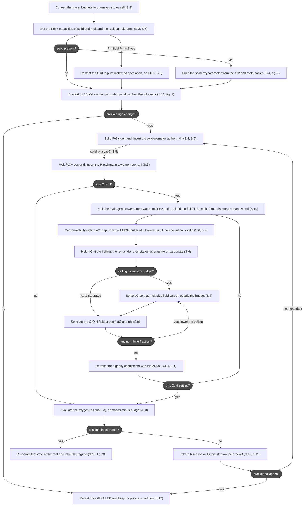
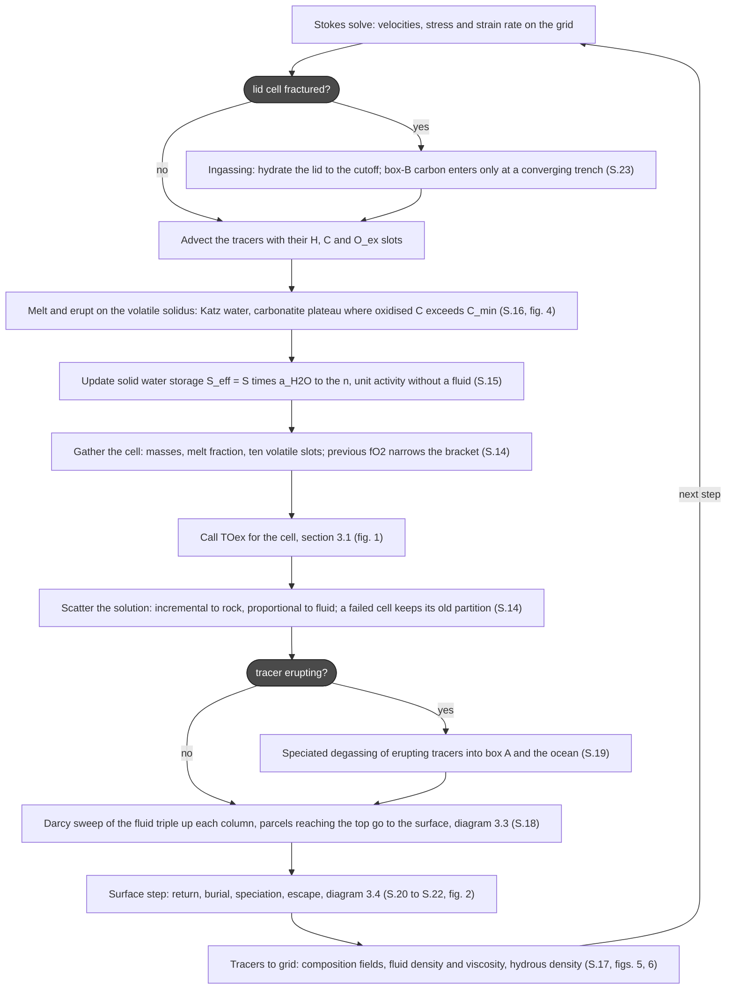
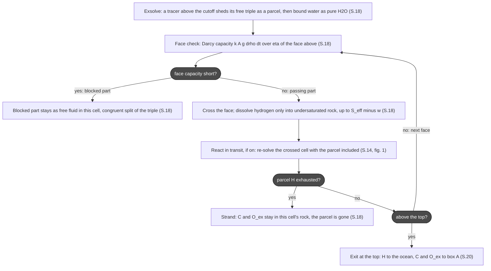
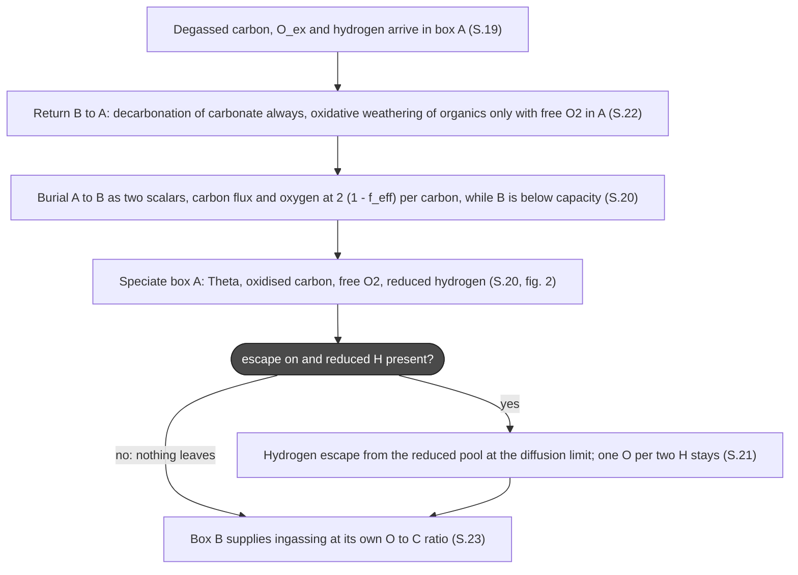
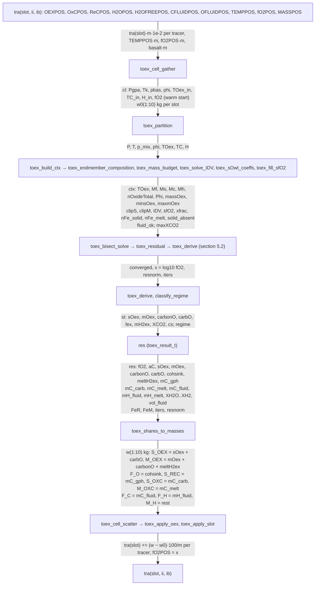
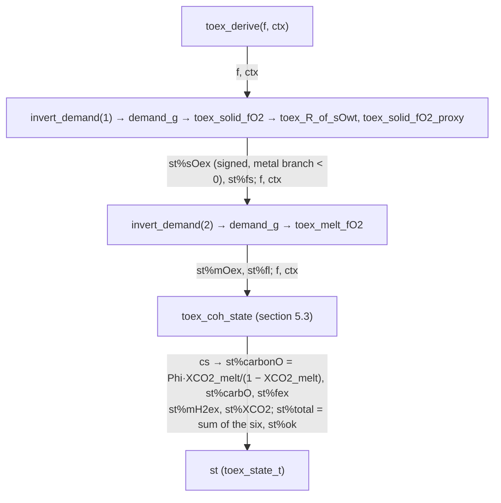
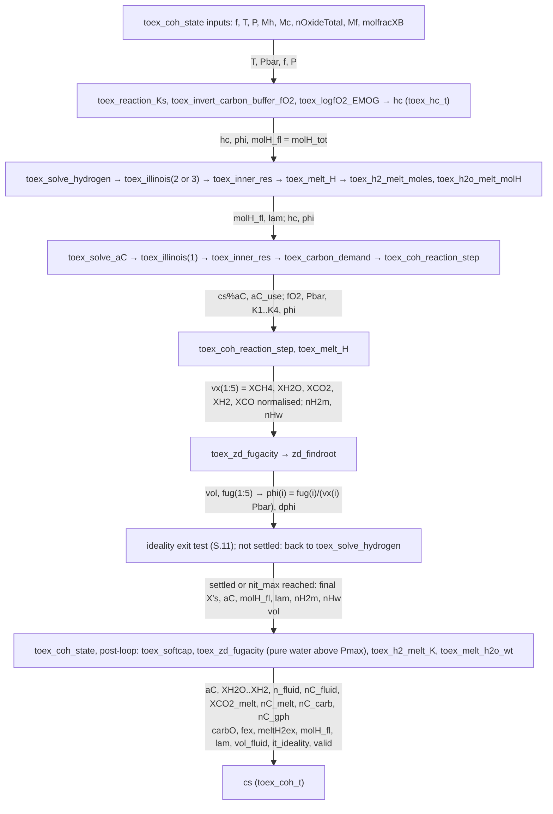

# TOex — overview

Companion: [TOex_math.md](TOex_math.md) holds the procedure, equations and sources behind every
event named below as `(S.n)`. Read the flowcharts here, follow the section numbers there.

## 1. Introduction

TOex is the volatile-redox module of the StagYY fork in `~/Desktop/watercarb`. It carries three
element ledgers on every tracer and in two surface boxes: hydrogen (as H₂O-equivalent), carbon,
and *excess oxygen* O_ex, the oxygen a parcel holds beyond a fully reduced reference (Fe as FeO,
C as graphite, H as H₂O). One number therefore records the redox state of any reservoir: CO₂ and
carbonate carry +2 O per C, CH₄ −2, H₂ −1, ferric iron +½ per Fe, metallic iron −1.

The core is a one-unknown solver. In a cell at (P, T) with a solid, a melt and a free C-O-H fluid,
all phases share one oxygen fugacity. Instead of solving for every phase's loading, TOex solves
for the shared log₁₀ fO₂ at which the oxygen the sinks demand equals the cell's O_ex budget. Every
other quantity, Fe³⁺/ΣFe of solid and melt, dissolved CO₂ and H₂O, the fluid's speciation and
density, graphite versus carbonate, is read off at that root.

Around the solver, StagYY moves the ledgers: tracers advect them, the melting law reads the
carbonate and water they carry, a Darcy sweep moves the free fluid up columns as an element
triple, erupting tracers degas by speciation into an atmosphere-ocean box, burial and weathering
exchange with a crustal box, hydrogen escapes, and subduction ingasses surface carbon and water
back into the mantle.

The reference implementation is `src/TOex.jl` (StagPP.jl); the Fortran port lives in
`volatiles_mod.f90` (solver), `volatileprocs_mod.f90` (transport, surface, bookkeeping) and
`volatiles_bind.f90` (table hook). A stand-alone copy of the solver is
`Perple_X_MAGEMin/MAGEMin/TOex.jl` in the StagYY tree.

## 2. Goal

Model the coupled water-carbon-oxygen cycle of a convecting mantle with a redox state that is a
*consequence*, not a prescription:

- the mantle's fO₂ follows from its iron and its volatile inventory, cell by cell, every step;
- carbon speciates by that fO₂ (diamond/graphite, carbonate, CO₂ in melt, C-O-H fluid), which
  decides whether it melts, moves and degasses;
- the surface's oxidation state emerges from what degasses, what is buried and what hydrogen is
  lost to space;
- all of it conserves carbon exactly, hydrogen except for escape, and O_ex except for escape.

The reference runs that anchor every volatile experiment are the nine `EarthWater/Reference`
cases (water only, carbon only, both, at three reference viscosities).

## 3. Workflow

Rectangles are events, arrows carry the question that selects them. `(S.n)` is the section of
`TOex_math.md` with the procedure.

### 3.1 The TOex solver (one cell)

Inputs: P, T, basalt fraction p, melt fraction ϕ, and the cell's O_ex, carbon and hydrogen.
Output: fO₂ and the full partition. Fortran `toex_partition`, Julia `partition_Oₑₓ`.

At the root the model reports sOₑₓ, mOₑₓ (iron of solid and melt), carbonO (melt CO₂), carbO
(solid carbonate), fₑₓ (net fluid oxygen, signed), mH2ₑₓ (melt H₂), the melt's water, the fluid's
mole fractions, molar mass and density, and a regime label. Carbon and hydrogen close exactly at
every trial f; the outer solve is on oxygen alone.

### 3.2 The StagYY implementation (one timestep)

The solve sits in the melting block of the tracer step (`TraMeltErupt`). Before it, the cell
budgets are produced; after it, what the solve placed is moved.

Two lags are deliberate and one step long: the melting law reads last step's carbonate fraction,
the solid storage reads last step's water activity. Fluid density and viscosity come from the
solve of the same cell, so they need no grid-to-tracer interpolation.

### 3.3 The Darcy sweep (free fluid)

The fluid is the only reservoir that moves other than by advection. It moves as the element
triple (H as H₂O-equivalent, C, O_ex), never as a redox label. Fortran
`WaterSaturationAndVerticalRedistribution`.

The sweep runs D1 for every cell of a column, bottom to top; a parcel keeps looping D2 to D4 until
it is blocked, stranded or exits. Every merge and subdomain hand-over asserts the window
−n_H/2 ≤ n_Oex ≤ 2 n_C.

### 3.4 The surface reservoirs

Two boxes, each a (C, O_ex) pair: A is atmosphere plus ocean and receives degassing; B is the
ingassable crust and sediment. Hydrogen in A splits into water and reduced hydrogen by the same
O_ex arithmetic. Fortran `toex_surface_step`, once per step after degassing.

## 4. Figures

Stored in `md_figs/`, generated by `md_figs/scripts/` (see its README). Diagram events cite them as "fig. n".

**Figure 1. TOex convergence statistics.** Per-step counters of the local run (return legs on, corrected tables, core cooling on; 2.92 Gyr so far): cells solved and failed by the main solve (T7), cells re-solved in transit by the Darcy sweep (D4), root iterations, which bracket the warm start used (S.12), ZD09 root failures and stranded fluid (S.9, S.18), and the solver wall time.

**Figure 2. Surface reservoirs of the local run (return legs on, core cooling on; 2.92 Gyr so far).** Ocean, mantle water and escape (S.21, S.24); carbon in box A, box B and the mantle; the box A ledgers and the free O₂ implied by Θ_A (S.20); exchange fluxes; redox of the boxes; where the volatiles sit (diagram 3.4).

**Figure 3. Radial redox and carbon structure.** Horizontal means of the local run (core cooling on) at 0.73, 1.45 and 2.91 Gyr: fO₂ (S.4, S.13), Fe³⁺/ΣFe (S.4, S.5), the O_ex ledger (S.1), oxidised and reduced solid carbon (S.6, S.7), melt CO₂ (S.8).

**Figure 4. Volatile-enhanced melting laws.** The law behind T4 (S.16) with the run parameters: the Katz water depression, the carbonated solidi with ledge and taper against the data, the carbonatite plateau in T(f), and the two gates S_c and s_l.

**Figure 5. Rheological hooks.** What water does to the solid: the Karato viscosity law, the brittle and ductile yield factors (T1, S.23 fracture test), and the hydrous density tables of solid and melt (T12, S.17).

**Figure 6. Rheological consequences in the run.** The 2-D frame of the local run (core cooling on) at 2.92 Gyr: viscosity, bulk water, saturation and density residual maps, viscosity against saturation by depth, and radial means of water, saturation and melt.

**Figure 7. Where the solid oxybarometer table samples MAGEMin.** The 36 nodes of the signed ferric-ratio axis of StagfO2.dat (S.4) at 5 GPa, 1700 K: on the linear R axis, on the asinh interpolation coordinate, and their spacing. Nodes are dense near the FeO reference where log fO₂ changes by ten units over 10⁻³ in R, sparse along the log-linear tail, and tighten again towards R = 0.95 where the R/(1 − R) form diverges.

**Figure 8. Carbonate leg of the melting law: fixed shift versus lever rule (scratch build, not ported).** (a) T_melting(f) at 15 GPa for three carbonate contents under the coded law (silicate solidus lowered by a fixed 100 K, solid) and the lever rule of eq. 16.12 (dashed). (b) The same as f(T): the shift gives one silicate productivity whatever c_oxC, the lever rule scales it with c_oxC. (c) Both laws on the horizontal-mean profile of the local run at 2.91 Gyr against the melt fraction it carries. (d) Two 20-step continuations of the 2.5 Gyr production frame with the scratch binary, `carb_lever_rule` off and on. The lever rule with a linear liquidus produces more transition-zone melt than the shift, because the eutectic drop there is ~600 K and even diluted five-fold it exceeds 100 K; see S.16.

Missing and worth making: a (P, T) map of where the C-O-H fluid exists and where the solve fails
(S.9, S.12); a schematic of the Darcy parcel with its two transfer rules (S.18).

## 5. Data flow through the code

The cell solve of section 3.1 read as code. Each box names a routine and the helpers it calls
(→), or a data structure; each arrow carries the variables handed to the next box. Three levels,
each zooming into one box of the level above.

### 5.1 One cell: tracers in, tracers out

`res` also fills the grid diagnostics (`toex_diag`: dFMQ, dIW, melt XCO2 and XH2, Fe³⁺, Fe⁰, COH index) and the per-cell fluid density `toex_rhof` from `vol_fluid`.

### 5.2 Inside toex_derive: the six sinks at one trial f

### 5.3 Inside toex_coh_state: carbon, hydrogen and the fugacity loop

Above `toex_fluid_Pmax` the loop is skipped: the fluid is frozen as pure water, `toex_solve_hydrogen` and `toex_melt_H` run once with `hc%aC_fixed`, and `toex_solve_aC` is called with `fl_ok = .false.` so only the melt demand counts.

Julia mirror in `src/TOex.jl` (StagPP): `partition_Oₑₓ` = `toex_partition`, `mass_budget`, `endmember_composition`, `solve_∫ΔVdP` = `toex_solve_IDV`, `bisect_solve` = `toex_bisect_solve`, `unified_residual` = `toex_residual`, `_coh_derive` = `toex_derive`, `coh_state` = `toex_coh_state`, `_coh_reaction_step` = `toex_coh_reaction_step`, `_carbon_demand` = `toex_carbon_demand`, `zd_fugacity` = `toex_zd_fugacity`, `melt_fO2` = `toex_melt_fO2`, `solid_fO2_interpolant` = `toex_fill_sfO2` plus `toex_solid_fO2`.
